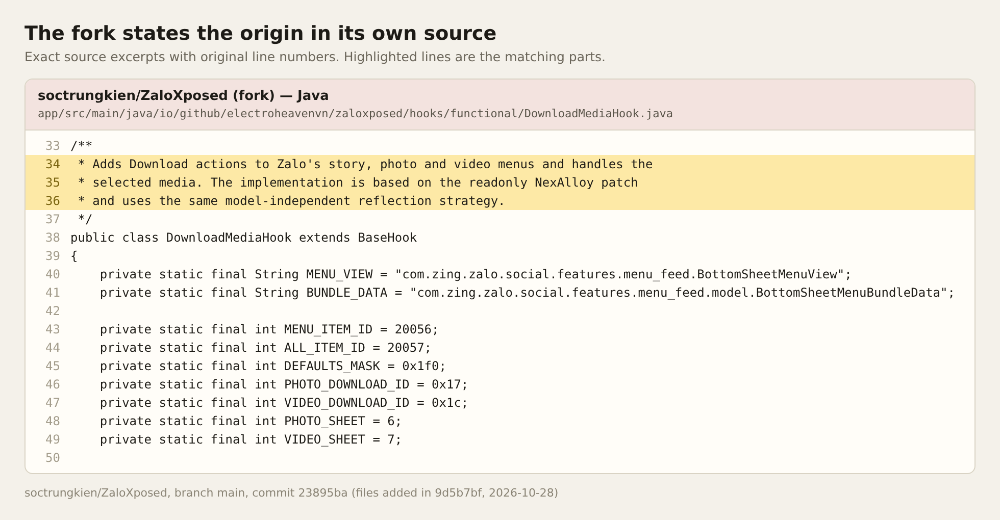
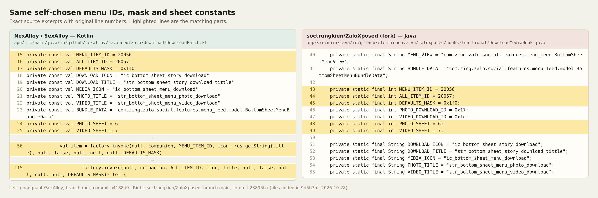
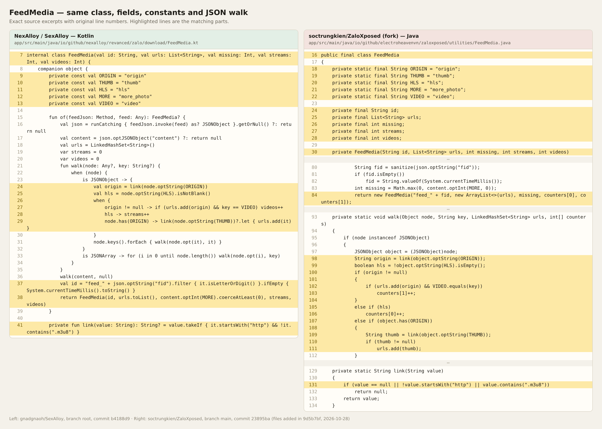
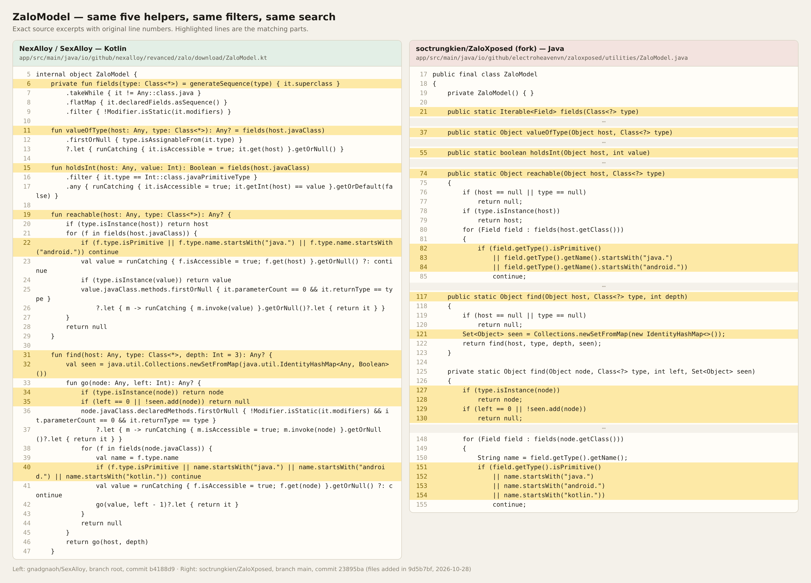
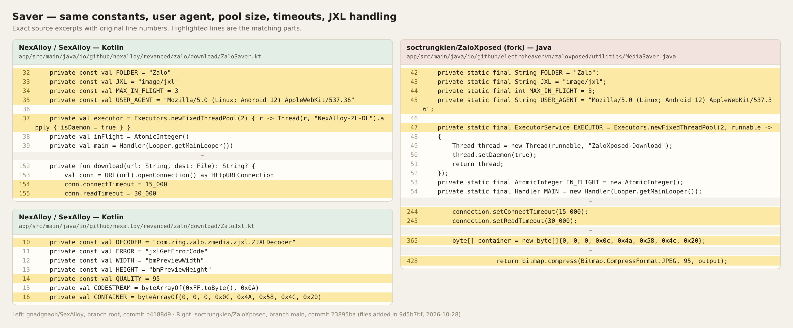
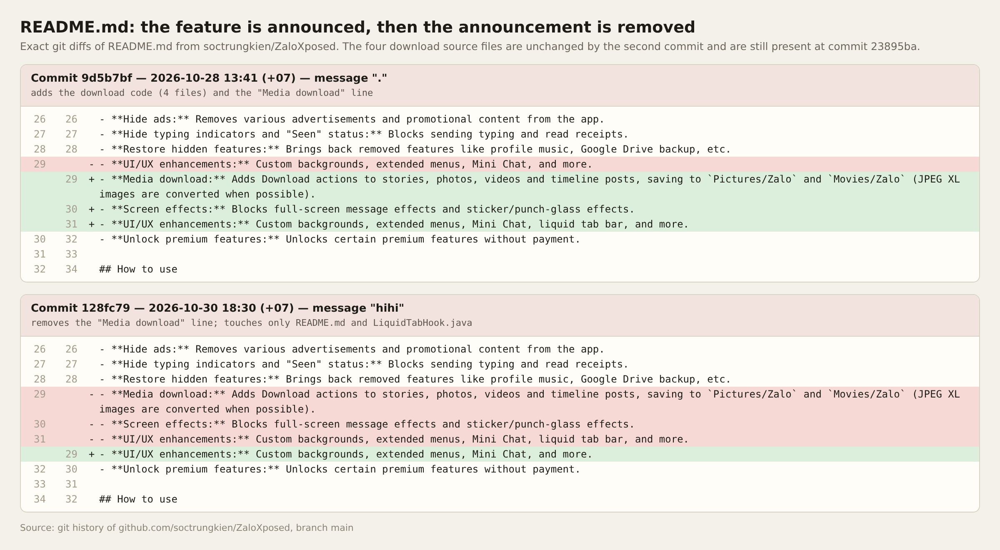

# Evidence: the Zalo download code in soctrungkien/ZaloXposed is taken from SexAlloy

The media download feature in the fork [soctrungkien/ZaloXposed](https://github.com/soctrungkien/ZaloXposed) is a Java port of the Zalo **Download** patch from [gnadgnaoh/SexAlloy](https://github.com/gnadgnaoh/SexAlloy) (package `io.github.nexalloy.revanced.zalo.download`).

Every image is an exact excerpt of the source files with their original line numbers. Nothing is retyped.

## What was compared

| | Repository | Commit |
|---|---|---|
| Original (Kotlin) | gnadgnaoh/SexAlloy, branch `root` | `b4188d9` |
| Port (Java) | soctrungkien/ZaloXposed, branch `main` | `23895ba` (2026-11-01) |

All four ported files were added to the fork in one commit by `soctrungkien`: `9d5b7bf`, dated 2026-10-28, with the commit message ".".

The upstream project [ElectroHeavenVN/ZaloXposed](https://github.com/ElectroHeavenVN/ZaloXposed) does not contain these files in its `main`, `dev` or `microg` branches (checked 2026-11-12). This evidence concerns the fork only.

## 1. The fork's own source names the origin

The class comment of `hooks/functional/DownloadMediaHook.java`, lines 34–36, says the implementation "is based on the readonly NexAlloy patch and uses the same model-independent reflection strategy". The comment is already present in commit `9d5b7bf`.

Upstream [NexAlloy/NexAlloy](https://github.com/NexAlloy/NexAlloy) has no Zalo code. The only "NexAlloy patch" for Zalo download is the one in SexAlloy, which keeps the `io.github.nexalloy` package name.

## 2. File-by-file mapping

| SexAlloy (Kotlin) | soctrungkien/ZaloXposed (Java) | What matches |
|---|---|---|
| `DownloadPatch.kt`, `Fingerprints.kt` | `hooks/functional/DownloadMediaHook.java` | Menu IDs `20056` / `20057`, `DEFAULTS_MASK = 0x1f0`, `PHOTO_SHEET = 6`, `VIDEO_SHEET = 7`, the same resource-name constants, the same 10-argument menu-item factory call |
| `FeedMedia.kt` | `utilities/FeedMedia.java` | Class name, the five fields `id, urls, missing, streams, videos`, the five constants, the `walk` / `link` logic, the `"feed_"` prefix |
| `ZaloModel.kt` | `utilities/ZaloModel.java` | Class name, the five helpers `fields`, `valueOfType`, `holdsInt`, `reachable`, `find`, the `java.` / `android.` / `kotlin.` filters, the identity-set depth search |
| `ZaloSaver.kt`, `ZaloJxl.kt` | `utilities/MediaSaver.java` | `FOLDER`, `JXL`, `MAX_IN_FLIGHT = 3`, the identical `USER_AGENT` string, a 2-thread pool, 15 s / 30 s timeouts, the JXL container signature, JPEG quality 95 |

## 3. Menu IDs and constants

`20056` and `20057` are not Zalo values. The original patch invented them for its own "Download" and "Download all" menu entries. The same numbers and the same constant names appear in the port.

## 4. `FeedMedia`

## 5. `ZaloModel`

## 6. Saver and JXL handling

## 7. The feature was announced in the README, then the announcement was removed

Commit `9d5b7bf` (2026-10-28), the same commit that adds the four download files, also adds a "Media download" line to the feature list in `README.md`.

Two days later, commit [`128fc79`](https://github.com/soctrungkien/ZaloXposed/commit/128fc79c1ddb0cc42c1b192f3f8e84ef91bd99ba) (2026-10-30, message "hihi") deletes that line and restores the previous wording. That commit changes only `README.md` and `LiquidTabHook.java`. It does not touch the download code, and all four download files are still present at `23895ba`.

The result is a fork that ships the ported download feature while its README no longer mentions it.

---

# Bằng chứng: code download Zalo trong soctrungkien/ZaloXposed được lấy từ SexAlloy

Tính năng tải media trong bản fork [soctrungkien/ZaloXposed](https://github.com/soctrungkien/ZaloXposed) là bản chuyển sang Java của patch **Download** cho Zalo trong [gnadgnaoh/SexAlloy](https://github.com/gnadgnaoh/SexAlloy) (package `io.github.nexalloy.revanced.zalo.download`).

Mọi hình ảnh đều là trích đoạn nguyên văn từ file nguồn, giữ đúng số dòng gốc. Không có dòng nào được gõ lại.

## Hai bên được so sánh

| | Repository | Commit |
|---|---|---|
| Bản gốc (Kotlin) | gnadgnaoh/SexAlloy, nhánh `root` | `b4188d9` |
| Bản chuyển (Java) | soctrungkien/ZaloXposed, nhánh `main` | `23895ba` (01/11/2026) |

Cả bốn file được chuyển sang đều được `soctrungkien` thêm vào fork trong cùng một commit: `9d5b7bf`, ngày 28/10/2026, nội dung commit là ".".

Dự án gốc [ElectroHeavenVN/ZaloXposed](https://github.com/ElectroHeavenVN/ZaloXposed) không chứa các file này ở các nhánh `main`, `dev`, `microg` (kiểm tra ngày 12/11/2026). Bằng chứng này chỉ nói về bản fork.

## 1. Chính mã nguồn của fork ghi rõ nguồn gốc

Chú thích đầu class trong `hooks/functional/DownloadMediaHook.java`, dòng 34–36, viết rằng phần cài đặt "is based on the readonly NexAlloy patch and uses the same model-independent reflection strategy" (dựa trên patch NexAlloy và dùng cùng chiến lược reflection). Chú thích này có sẵn ngay từ commit `9d5b7bf`.

Dự án [NexAlloy/NexAlloy](https://github.com/NexAlloy/NexAlloy) gốc không có code Zalo nào. "Patch NexAlloy" duy nhất cho việc tải media Zalo là patch trong SexAlloy, vốn giữ tên package `io.github.nexalloy`.

## 2. Đối chiếu từng file

| SexAlloy (Kotlin) | soctrungkien/ZaloXposed (Java) | Điểm trùng |
|---|---|---|
| `DownloadPatch.kt`, `Fingerprints.kt` | `hooks/functional/DownloadMediaHook.java` | ID menu `20056` / `20057`, `DEFAULTS_MASK = 0x1f0`, `PHOTO_SHEET = 6`, `VIDEO_SHEET = 7`, cùng các hằng tên resource, cùng lời gọi factory tạo mục menu với 10 tham số |
| `FeedMedia.kt` | `utilities/FeedMedia.java` | Tên class, năm field `id, urls, missing, streams, videos`, năm hằng số, logic `walk` / `link`, tiền tố `"feed_"` |
| `ZaloModel.kt` | `utilities/ZaloModel.java` | Tên class, năm hàm `fields`, `valueOfType`, `holdsInt`, `reachable`, `find`, bộ lọc `java.` / `android.` / `kotlin.`, cách tìm theo độ sâu với tập identity |
| `ZaloSaver.kt`, `ZaloJxl.kt` | `utilities/MediaSaver.java` | `FOLDER`, `JXL`, `MAX_IN_FLIGHT = 3`, chuỗi `USER_AGENT` giống hệt, pool 2 thread, timeout 15 giây / 30 giây, chữ ký container JXL, chất lượng JPEG 95 |

## 3. ID menu và hằng số

`20056` và `20057` không phải giá trị của Zalo. Patch gốc tự đặt hai số này cho mục "Download" và "Download all" của riêng nó. Bản chuyển dùng đúng hai số đó và đúng các tên hằng đó.

## 4. `FeedMedia`

## 5. `ZaloModel`

## 6. Phần lưu file và xử lý JXL

## 7. Tính năng từng được ghi trong README, sau đó dòng ghi đó bị xoá

Commit `9d5b7bf` (28/10/2026), cũng là commit thêm bốn file download, có thêm dòng "Media download" vào danh sách tính năng trong `README.md`.

Hai ngày sau, commit [`128fc79`](https://github.com/soctrungkien/ZaloXposed/commit/128fc79c1ddb0cc42c1b192f3f8e84ef91bd99ba) (30/10/2026, nội dung "hihi") xoá dòng đó và trả lại câu chữ cũ. Commit này chỉ sửa `README.md` và `LiquidTabHook.java`. Nó không đụng tới code download, và cả bốn file download vẫn còn nguyên ở `23895ba`.

Kết quả là bản fork vẫn phát hành tính năng download được chuyển sang, trong khi README không còn nhắc tới nó.

